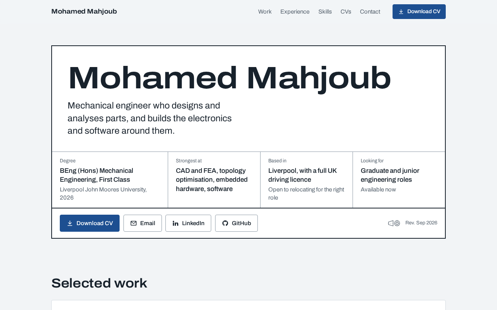

# Mohamed Mahjoub, portfolio

Source for **[probler.uk](https://probler.uk)**: my projects, experience and downloadable CVs.



I'm a First Class BEng (Hons) Mechanical Engineering graduate from Liverpool John Moores University, based in Liverpool. I design and analyse parts (CAD, FEA, topology optimisation) and build the electronics and software that go around them.

- **Email:** MohamadMahjoub21@gmail.com
- **LinkedIn:** [mohamed-mahjoub-457b2421b](https://www.linkedin.com/in/mohamed-mahjoub-457b2421b/)

## What's on the site

| Section | Contents |
| --- | --- |
| Title block | Degree, strengths, location and availability, laid out like the title block on an engineering drawing |
| Selected work | Dissertation, ScrimLabs, the in-car speed limit display, the vision-tracked robot, plus shorter entries for the robot arm, MacroPad and the BeamNG addon |
| Experience | QA testing, Formula Student, vehicle mechanic work and the DSTL award |
| Education | LJMU degree with final-year module marks, and Level 3 qualifications |
| Skills | Design and analysis, workshop, electronics, software, languages |
| CVs | Three one-page PDFs, one per discipline |
| Contact | Email, LinkedIn, GitHub |

### The CVs

Three versions of the same one-page CV live in [`public/cv/`](public/cv), each leading with a different side of my work:

- **Mechanical and design**: CAD, FEA and workshop skills first. The default download.
- **Electrical and embedded**: hardware, firmware and packaging it in CAD.
- **Software and QA**: for test, QA and software development roles.

### Featured projects

- **Formula Student suspension upright** (final-year dissertation). Topology optimisation and FEA of a 2014-T6 aluminium upright across three load cases plus modal analysis in SolidWorks Simulation. 45.2% lighter at a 331 MPa peak stress, with a minimum safety factor of 1.25.
- **[ScrimLabs](https://scrimlabs.com)**. A Discord bot and React statistics website running competitive scrims for The Finals community. The bot owns the database and serves an Express API; the site reads through it. Deployed on DigitalOcean with GitHub Actions. ([bot overview](https://github.com/Probler-Yt/ScrimBot))
- **In-car speed limit display**. A Kotlin Android app looks up the limit in an offline OpenStreetMap database and sends it over Bluetooth to an ESP32 driving a round TFT screen, in a 3D printed enclosure.
- **[Autonomous robot with vision tracking](https://github.com/Probler-Yt/SensorsAndRobotics)**. An Arduino robot driving a set route unaided, tracked in MATLAB from fixed camera footage. Scored 94%.

## Editing the site

All of the copy lives in one file, [`src/content.ts`](src/content.ts): the title block, every project, experience, education, skills and the CV list. Changing text there is usually all that's needed, with no component edits.

To swap a CV, drop a new PDF into [`public/cv/`](public/cv) using the same filename, then update the matching `size` in `src/content.ts`.

```
src/
  content.ts            all site copy in one place
  styles.css            design tokens, layout, dark mode
  App.tsx               section order
  components/
    Header.tsx          sticky bar with the CV button
    TitleBlock.tsx      the hero, drawn as a drawing title block
    Work.tsx            projects
    MassDiagram.tsx     dimensioned mass comparison (inline SVG)
    Experience.tsx      experience and education
    Skills.tsx          grouped skills
    CVs.tsx             CV downloads
    Contact.tsx         contact details and footer
    Icons.tsx           inline SVG icons
public/
  cv/                   the three CV PDFs
  favicon.svg           first-angle projection symbol
  og.png                link preview image
```

## Design notes

The layout borrows from engineering drawings: the hero is a title block, the corner carries a first-angle projection symbol, and the dissertation's mass saving is drawn as a dimensioned comparison with the removed material hatched. Cool paper grey, graphite ink and a single drawing blue, with a dark theme that follows the reader's system setting. Type is [Archivo](https://fonts.google.com/specimen/Archivo), a variable font whose width axis does the work in the headings.

## Stack

React, TypeScript and Vite, with plain CSS in [`src/styles.css`](src/styles.css) and Archivo self-hosted through Fontsource. No CSS framework and no analytics.

```bash
npm install
npm run dev        # local dev server
npm run build      # production build into dist/
npm run typecheck  # tsc, no emit
npm run lint       # eslint
```

## Deployment

Every push to `main` triggers [`.github/workflows/deploy.yml`](.github/workflows/deploy.yml), which builds the site and publishes `dist/` to GitHub Pages, served at the custom domain probler.uk.

---

© 2026 Mohamed Mahjoub. Code is free to learn from; the CV content, project write-ups and images are not for reuse.
