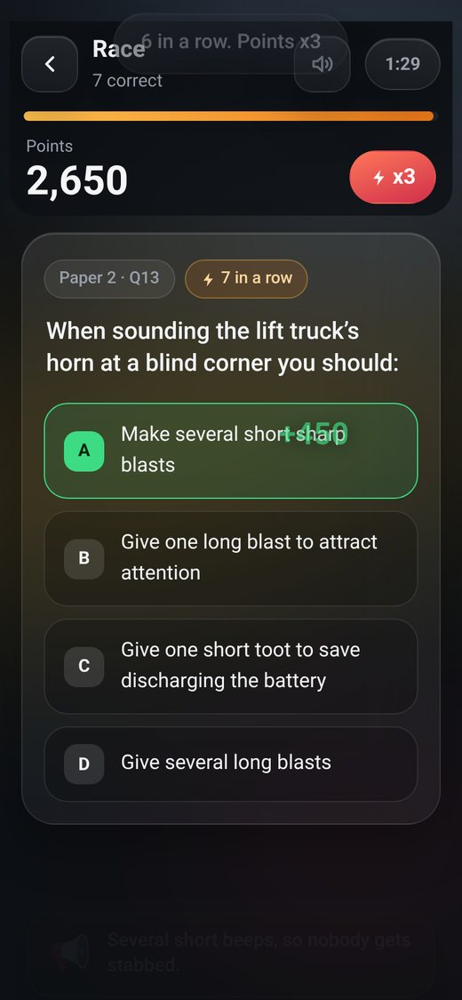
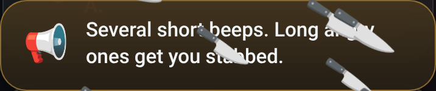
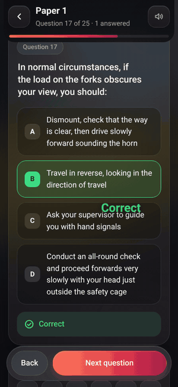
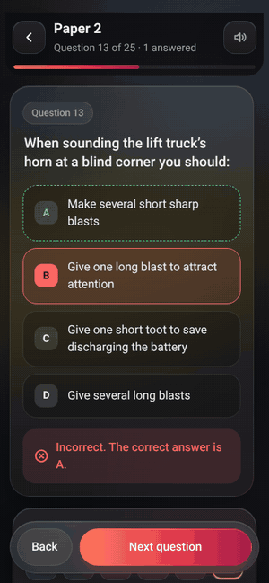

# Forklift Theory Practice

**[probler.uk/FTL](https://probler.uk/FTL)** has the three counterbalance (LTG1 · B1/B4) theory papers, word for word, on any phone or computer. There's nothing to install and no login.

  
  
  

## Three modes

- **Practice:** answer a question, press Check, and see straight away if you're right.
- **Exam:** the real thing. 30 minutes and marked at the end. You pass with 20/25, and Q6 to Q10 must all be right.
- **Race:** 90 seconds of mixed questions. Answer fast and build streaks for more points (x2, x3, x4). A wrong answer costs 3 seconds. Afterwards, send your score to a mate and they race the same questions.

## Class jokes

These pop up after the matching question.

 
 
 
 
 
 

  
  
  

---

Made by <b>Mohamed Mahjoub</b> · <a href="https://probler.uk">probler.uk</a> · Visits are counted anonymously with no cookies. Questions are from the LTG1 B1/B4 papers, for class revision. This is not an official test.
