# Forklift Theory Practice

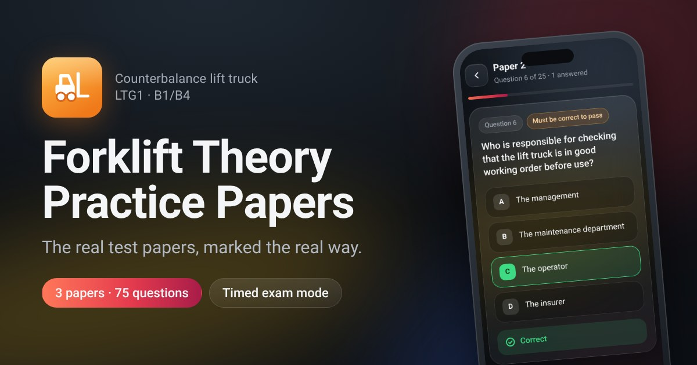

Practice papers for the **counterbalance lift truck (LTG1 · B1/B4) knowledge test**, built for our class by Mohamed Mahjoub.

**Open it here: [probler.uk/FTL](https://probler.uk/FTL)**

It works on any phone, tablet or computer. There's nothing to install and no account to make. Pick a mode, pick a paper and go.

---

### Contents

[At a glance](#at-a-glance) · [Home screen](#home-screen) · [Practice](#practice-mode) · [Exam](#exam-mode) · [Race](#race-mode) · [Results](#results) · [Challenge a mate](#challenge-a-mate) · [Every pop-up](#every-pop-up-and-what-triggers-it) · [Sounds](#sounds) · [Class jokes](#class-jokes) · [Good to know](#good-to-know)

---

## At a glance

- **The real papers.** Papers 1, 2 and 3 match the test word for word, in the same order.
- **Marked the real way.** You need 20 out of 25 to pass, and questions 6 to 10 must all be correct.
- **Three modes.** Practice shows the answer as you go. Exam is timed and only marked at the end. Race is a 90-second points game.
- **Made to keep people going.** It has sound effects, streaks, confetti, the class jokes, and challenge links so you can race your mates.

## Home screen

  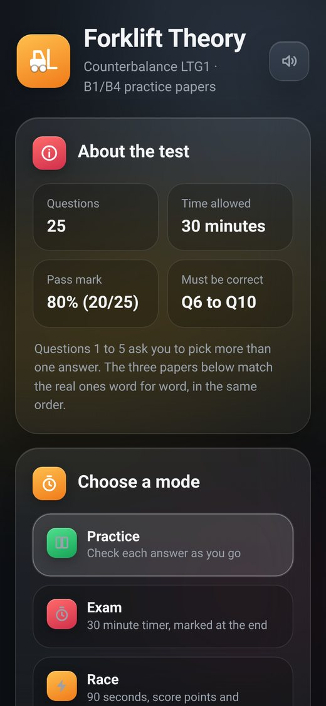
  &nbsp;
  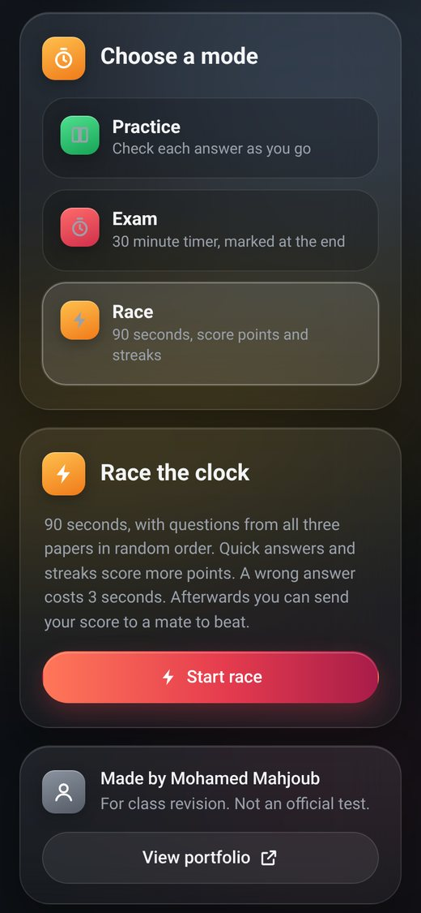

| Part | What it does |
|---|---|
| **About the test** | The rules at a glance: 25 questions, 30 minutes, 80% to pass, and Q6 to Q10 must be correct. |
| **Choose a mode** | Pick Practice, Exam or Race. The app remembers your last choice. |
| **Choose a paper** | Papers 1, 2 and 3. Each one shows your best score and whether you've passed it. |
| **Race the clock** | Shown instead of the papers when Race is picked, because a race uses questions from all three papers. |
| **Speaker button** (top right) | Turns sound on or off. It's on every screen and the app remembers your setting. |

## Practice mode

  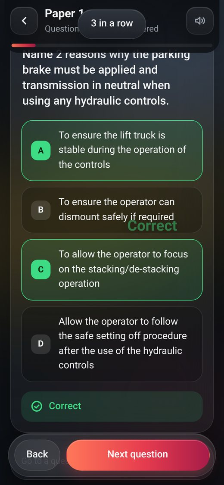
  &nbsp;
  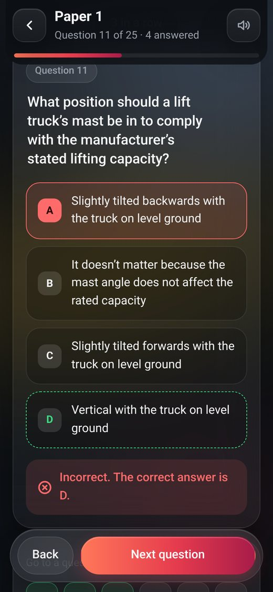

1. Tap an answer, or several on Q1 to 5. The button tells you how many more to pick.
2. Press **Check answer**.
3. The answers are coloured to show how you did:
   - **Green:** you got it right.
   - **Red:** you picked it, but it's wrong.
   - **Dashed green:** the right answer you missed.
4. A box underneath says "Correct", or tells you which answer was right.
5. Press **Next question**.

You can tap **Go to a question** to jump around the paper. The grid shows green and red for answers you've checked, and an orange underline on the must-pass questions.

## Exam mode

  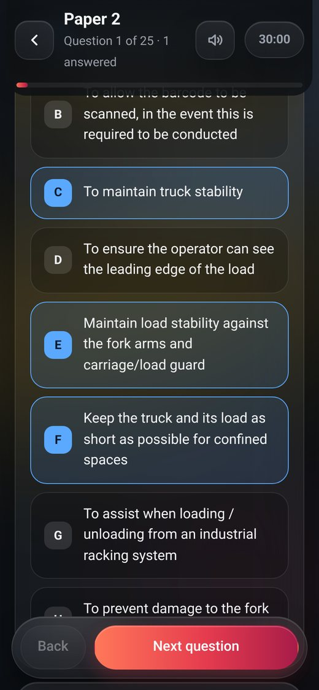
  &nbsp;
  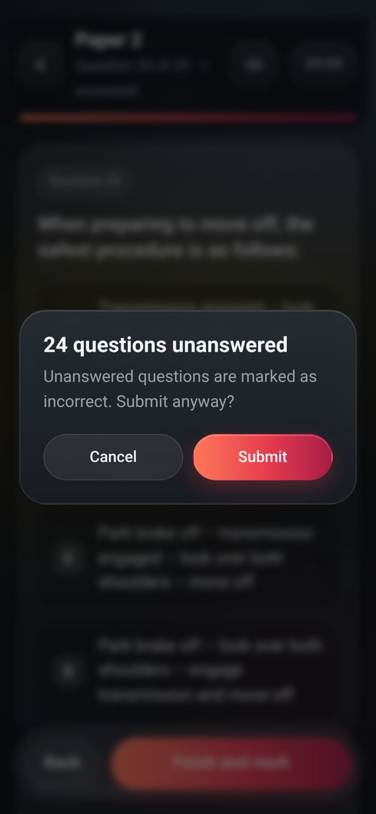

- A 30-minute countdown runs in the top corner. It turns red with 5 minutes left and submits by itself when time runs out.
- No answers are shown until the end, just like the real test.
- You can go back, change answers and jump between questions.
- **Finish and mark** warns you first if any questions are unanswered.

## Race mode

  
  &nbsp;
  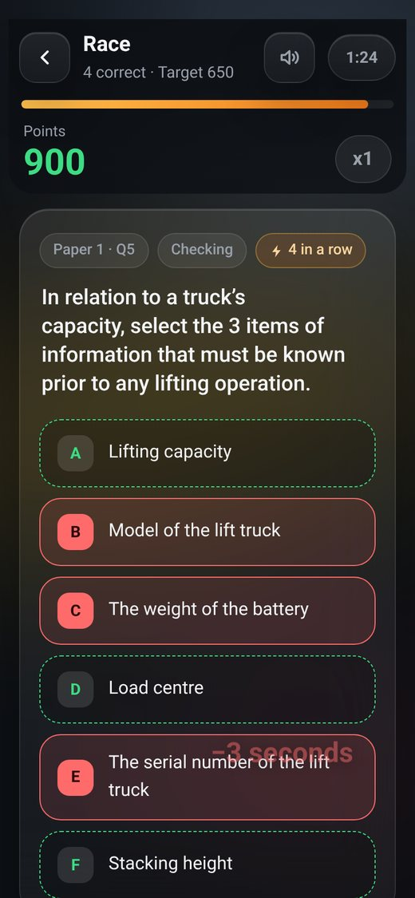

You get 90 seconds to answer as many questions as you can. The questions come in a random order from the 50 different ones across all three papers.

| | How it works |
|---|---|
| **Points for a correct answer** | 100 points, or 150 for a "select several" question |
| **Speed bonus** | Up to 50 extra points. You get the full bonus if you answer within 2.5 seconds, and it drops to nothing by 10 seconds. |
| **Streak multiplier** | 3 in a row gives **x2**, 6 in a row gives **x3**, and 10 in a row gives **x4**. The bonus is applied to the whole score for that answer. |
| **Wrong answer** | You lose 3 seconds and your streak resets. The page also scrolls to the right answer so you learn it. |
| **The clock** | It pauses while the answer is shown, so you're never penalised for reading. |
| **Last 10 seconds** | The timer turns red and ticks. |

Points, the multiplier and the timer stay pinned to the top of the screen, even on long questions.

## Results

  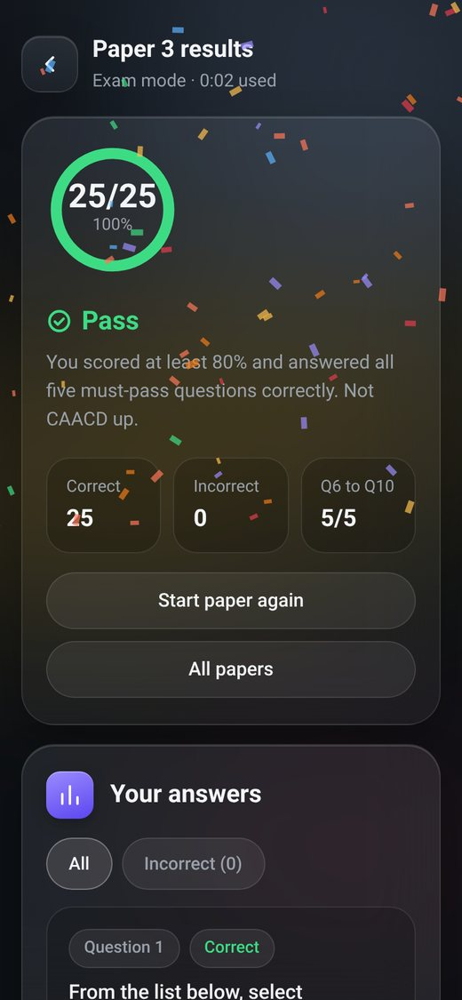
  &nbsp;
  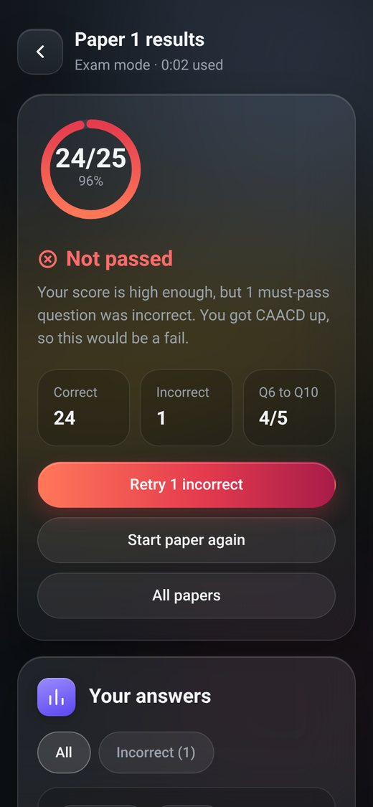
  &nbsp;
  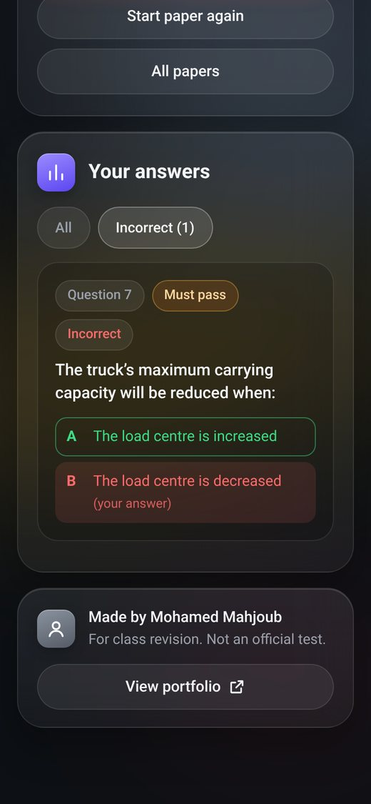

- **Pass** means 20 or more correct **and** all five must-pass questions right. A high score with a must-pass question wrong is still a fail, and the results say so (you got CAACD up).
- **Retry incorrect** starts a quick practice round of only the questions you got wrong.
- **Your answers** lists every question with your pick and the right one. Use the **Incorrect** filter to see just the mistakes.
- Your best score for each paper is saved on your device and shown on the home screen.

## Challenge a mate

  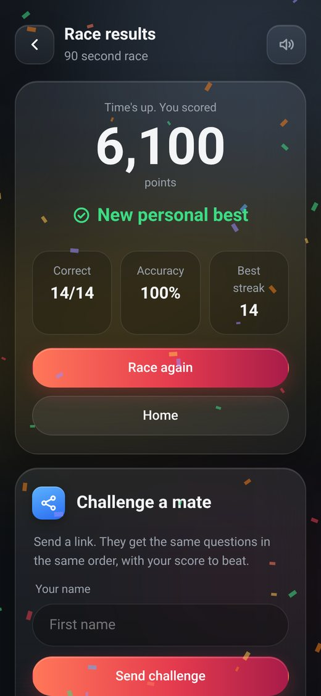
  &nbsp;
  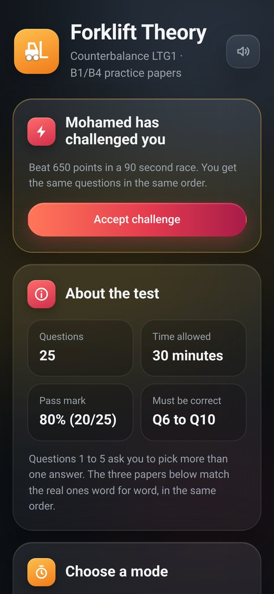
  &nbsp;
  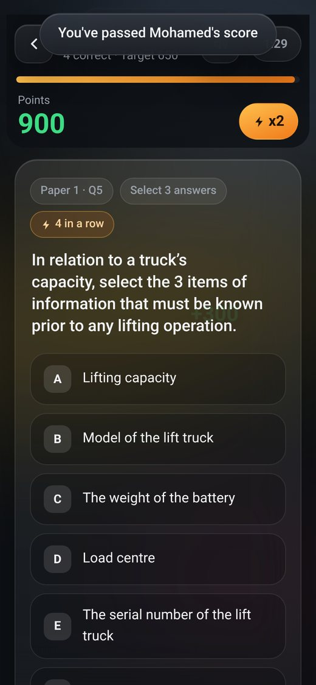

1. At the end of a race, type your name and press **Send challenge**. This opens your phone's share menu, so you can send it on WhatsApp or anywhere else. On a computer it copies the link.
2. Your mate opens the link and sees **"Mohamed has challenged you"** with the score to beat.
3. They get **the exact same questions in the same order**.
4. Their target is shown at the top. Their points turn green and a pop-up appears the moment they overtake you.
5. At the end it says who won and by how much, and there's a **Rematch** button.

## Every pop-up and what triggers it

| Pop-up | When it appears | Mode |
|---|---|---|
| **"Correct"** (green, next to the answer) | Right answer | Practice |
| **"+250"** (green, next to the answer) | Right answer, showing the points scored | Race |
| **"−3 seconds"** (red) | Wrong answer | Race |
| **Card shakes** | Wrong answer | Practice, Race |
| **Answer box under the question** | After pressing Check answer. P1 Q2 also says "any 4 of these" because 5 answers are accepted. | Practice |
| **"3 in a row"** (top banner) | At 3, 6, 10, 15 and 20 correct in a row | Practice |
| **"6 in a row. Points x3"** (top banner) | Each time the multiplier goes up | Race |
| **Multiplier badge** | Changes colour as it grows: x2 amber, x3 red, x4 purple with a glow | Race |
| **"You've passed Mohamed's score"** | The moment you overtake the person who challenged you | Challenge |
| **Joke banner** (bottom) | Answering one of the [joke questions](#class-jokes) | Practice, Race |
| **Rising emoji** | Chicken wings, horns or knives. [See the jokes](#class-jokes). | Practice, Race |
| **Confetti and fanfare** | Passing a paper, getting every question right in a retry round, a new race personal best, or winning a challenge | All |
| **"New personal best"** | Beating your best race score | Race |
| **Red timer** | Under 5 minutes in exam mode, or the last 10 seconds of a race | Exam, Race |
| **"Leave this paper?" / "Leave the race?"** | Pressing back mid-paper. The race clock pauses while this is open. | All |
| **"3 questions unanswered"** | Finishing an exam with gaps | Exam |
| **"Link copied" / "Challenge sent"** | After sharing a challenge | Race |

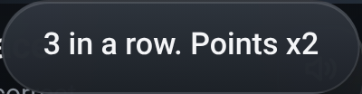

## Sounds

| Sound | When |
|---|---|
| Soft click | Tapping an answer or a button |
| Two-note chime | Right answer. It goes **one note higher for every answer in a row**, so a long streak climbs up the scale. |
| Low buzz | Wrong answer |
| Quick four-note rise | Hitting a streak milestone or a new multiplier |
| Ticking | Last 10 seconds of a race |
| Fanfare | Passing a paper, a new personal best, or winning a challenge |
| Two falling notes | Time's up, or a paper not passed |
| Four short beeps | Getting the horn question right |
| Knife "shing" | Getting the horn question wrong |

Android phones also vibrate on right and wrong answers. Sound is on by default and can be muted from the speaker button on any screen.

## Class jokes

The jokes pop up as a banner at the bottom of the screen after the matching question, in both Practice and Race. A right answer and a wrong answer each get their own line.

### Chicken wing 🍗
*Load blocks your view → travel in reverse* (P1 Q17, P2 Q16, P3 Q16)

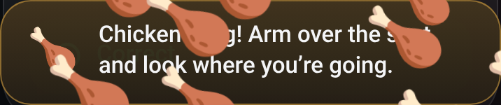 
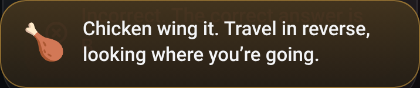

Get it right and cooked chicken wings float up the screen:

### So nobody gets stabbed 📢
*Horn at a blind corner → several short sharp blasts* (P2 Q13, P3 Q13)

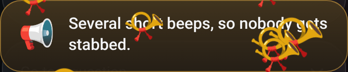 

Get it right and you hear four short beeps while horns float up. Get it wrong and knives float up instead.

  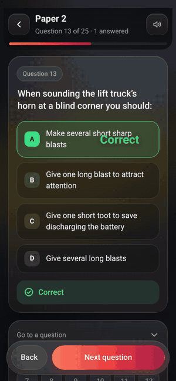
  &nbsp;
  

### Metal stillages 🔩
*Forks as wide as possible* (P1 Q15, P3 Q15)

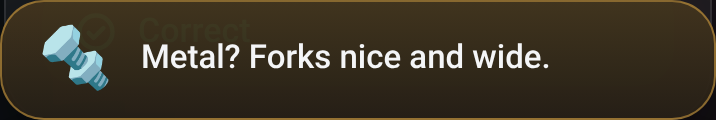 
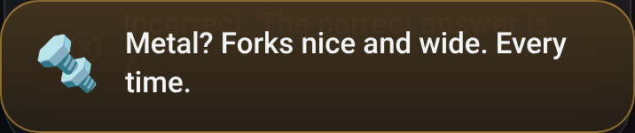

### Wooden pallets 🪵
*Forks spread to take equal weight* (P2 Q23)

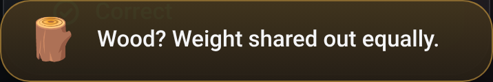 
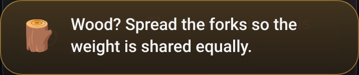

### Richard Head 🚶
*Stopping short of the stack, so people can't walk between* (P2 Q21, P3 Q3)

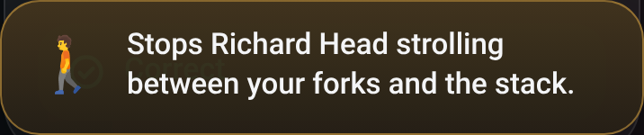 
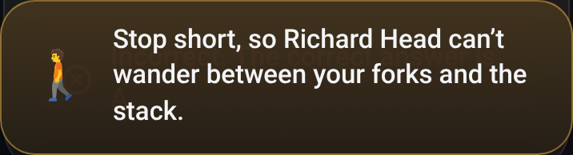

*Pedestrian safety is the operator's job* (P1 Q8, P2 Q8, P3 Q8)

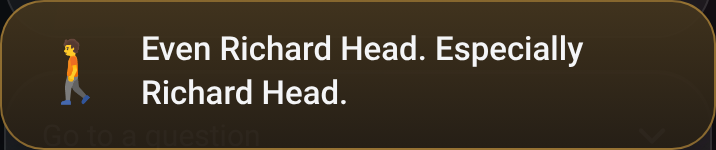 
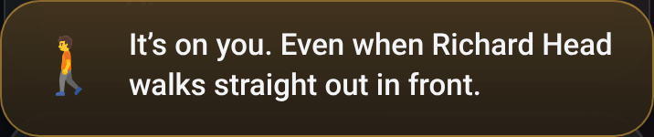

### CAACD 😬
The must-pass questions (Q6 to Q10) go **C, A, A, C, D** on all three papers. Get any of them wrong and:

The results screen also tells you if you got CAACD up, or that you didn't when you pass.

## Good to know

- **Saved on your own device only.** Best scores, your last mode, your name for challenges and the sound setting are all kept on your phone. Nothing is sent anywhere and there are no accounts.
- **Challenge links** only contain the race number, the score and the name typed in.
- **Hidden from Google.** Only people with the link will find it.
- **Keyboard shortcuts** on a computer: A to J or 1 to 9 pick an answer, Enter checks or moves on, and the arrow keys go back and forward.
- **Reduced motion.** If a device is set to reduce motion, the confetti and floating emoji are switched off.

## Coming next

- **Teacher mode:** large text for the projector, one question at a time, and a Reveal answer button.
- **Explanations:** a short "why" under each answer, plus more class jokes.

---

  Made by <b>Mohamed Mahjoub</b> · <a href="https://probler.uk">probler.uk</a> 
  Questions from the LTG1 B1/B4 associated knowledge papers, shared for class revision. This is not an official test.

